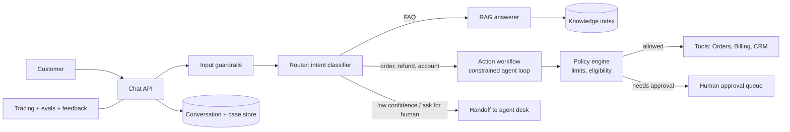

# Design a Customer Support Agent (Multi-Step Workflow)

An assistant that answers support questions from the knowledge base **and takes actions** (look up an order, issue a refund, reset access) in business systems, escalating to humans when needed. The challenge: **routing, safe actions with approval, and measurable resolution quality**.

## 1. Requirements

**Functional**
1. Customers chat; the agent classifies intent and answers from policies and the knowledge base with citations.
2. The agent performs account actions (order status, cancel, refund up to a limit, update address) using tools.
3. Escalate to a human with a summary and context when confidence is low, the customer asks, or policy requires.

**Out of scope**: voice channel, agent-assist UI for humans, analytics.

**Non-functional**
- 2M conversations/day (~25/s average, 150/s peak), avg 6 turns.
- TTFT under 2 s; full turn under 8 s including tool calls.
- Containment (resolved without human) above 60% with CSAT parity with humans.
- Zero unauthorized actions; every action audited and reversible where possible.
- Cost per resolved conversation under a set budget (for example 10 cents).

## 2. Core Entities

- **Customer**, **Conversation**, **Intent**, **Case** (ticket), **Action** (type, params, status, approval), **Policy**, **Handoff**

## 3. API

```text
POST /v1/conversations/{id}/messages   (SSE)   body: { text }
POST /v1/actions/{id}/approve          (human approval for gated actions)
POST /v1/conversations/{id}/handoff
GET  /v1/cases/{id}
```

Customer identity comes from the authenticated session; tools use **that customer's** scope.

## 4. Data Flow

1. Message arrives; guardrails screen input.
2. **Router** (small model) labels intent: FAQ, order status, refund, account change, complaint, other.
3. Handler runs: FAQ uses RAG; actions use a ReAct loop with a small tool set specific to the intent; sensitive intents use a fixed workflow.
4. Policy engine checks each action; high-risk actions request approval.
5. Response streams to the customer; the case and summary are updated; on handoff, the transcript and context go to a human queue.

## 5. High-Level Design



## 6. Deep Dives

### 6.1 Routing and workflow vs agent
Most traffic is a small set of intents. Route first with a cheap classifier, then run a **fixed workflow** for high-risk flows (refunds: verify identity, check eligibility, compute amount, confirm with customer, execute) and a **bounded ReAct loop** for flexible ones. Each handler sees only its own 3-6 tools, which raises tool-selection accuracy and cuts prompt size. See [Pattern Decision Cheat-Sheet](../02-core-concepts/04-agentic/agent-pattern-decision-cheat-sheet.md).

### 6.2 Safe actions
Reads are free; writes pass through the policy engine in code: refund cap per customer and per day, eligibility rules, fraud signals. Above the cap, or for new action types, a human approves (durable wait, see [Agent Runtime](agent-runtime.md)). Every action carries an idempotency key `conversationId:actionIntent` so retries and loops cannot double-refund. The agent **confirms the exact action with the customer** before executing. Compensation exists for reversible actions.

### 6.3 Identity and prompt injection
Customer-written text and retrieved documents are untrusted. Tools bind to the authenticated customer ID outside the model (the model cannot choose another customer's ID). A malicious message ("refund order 123 of another user") fails the authorization check, not a prompt rule. See [Security](../02-core-concepts/04-agentic/agent-security-safety-guardrails.md).

### 6.4 Handoff
Escalate on explicit request, repeated failure, low confidence, negative sentiment or regulated topics. Handoff payload: summary, intent, actions taken, retrieved evidence. Preserve the thread so the customer does not repeat themselves. Keep a human-capacity-aware queue; if no humans are available, offer a callback.

### 6.5 Quality loop
Outcome signals: resolution, reopen rate, CSAT, escalation reason. Sample conversations for LLM and human grading, add failures to the regression set, and gate prompt, model and policy changes. Shadow mode first: the agent drafts answers while humans send them, to calibrate before autonomy.

## 7. Staff-Level Notes

- **Trade-offs**: higher autonomy raises containment but also risk; start read-only plus low-value actions with approval, widen with data.
- **Failure modes**: wrong intent routing (fallback route, confidence thresholds), tool outage (apologize, create a case), policy drift between agent and backend (single source of truth in policy service), hallucinated policy (answers only from retrieved policy with citations).
- **Observability**: containment, escalation reasons, action success and rollback rate, cost per resolution, intent mix, groundedness, p95 turn latency.
- **Evolution at 10x**: multilingual, proactive outreach, per-segment policies, voice channel with streaming speech.

### Agentic Concerns

| Concern | Answer for this design |
|---|---|
| Quality and evals | Intent routing accuracy, groundedness, action correctness on simulated conversations, CSAT and reopen rate online; shadow mode before autonomy |
| Guardrails and security | Customer-bound tool identity, policy engine in code, injection-resistant design, approvals above limits, PII redaction |
| Cost per task | Small router, per-intent small tool sets, cheaper model for FAQ, cache retrieval, budget per conversation |
| Latency | Parallel read tools, streaming, skip LLM planning for deterministic flows |
| Fallback | Handoff to human, create a ticket, scripted response when models are down |
