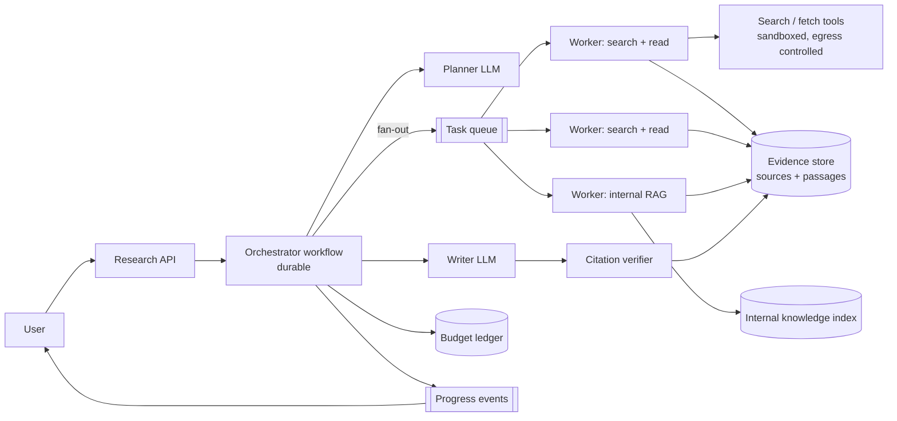
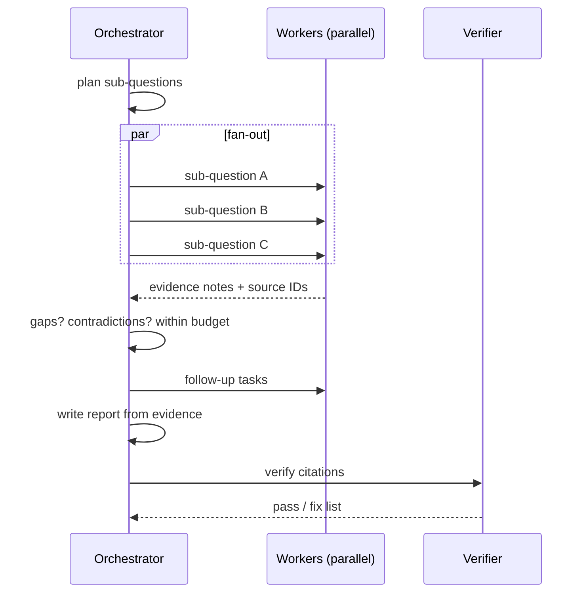

# Design a Deep Research Agent (Multi-Agent, Orchestrator-Workers)

Given an open question ("compare the regulatory outlook for X in EU and US"), the system plans, searches and reads many sources in parallel, and produces a cited report over minutes. The challenge: **dynamic task decomposition, parallel workers with small contexts, budgets, and citation integrity**.

## 1. Requirements

**Functional**
1. User submits a research question and optionally scope, depth and sources.
2. The system plans sub-questions, gathers evidence in parallel from the web and internal sources, and synthesizes a structured report with citations.
3. User can watch progress, refine the plan, cancel, and get the report as a document.

**Out of scope**: real-time chat, paid-source licensing, report editing UI.

**Non-functional**
- Run time 3-20 minutes depending on depth; progress events within 5 s of each step.
- Scale: 5k concurrent runs, each with up to 20 parallel workers, so up to 100k concurrent worker tasks.
- Cost: a run uses ~0.5-3M tokens (10-20x a chat), so hard cost caps per run and per tenant are essential.
- Quality: every claim traceable to a source passage; factual accuracy and coverage graded on a benchmark set.
- Safety: untrusted web content must not control the agent.

## 2. Core Entities

- **ResearchRun**, **Plan** (sub-questions, status), **Task** (worker assignment), **Source** (URL, fetched content, hash), **Evidence** (quote, source, relevance), **Report** (sections, citations), **Budget**

## 3. API

```text
POST /v1/research                 Idempotency-Key -> { runId }   body: { question, depth, budget }
GET  /v1/research/{id}            status, plan, partial report, cost
GET  /v1/research/{id}/events     SSE
POST /v1/research/{id}/plan       edit or approve plan
POST /v1/research/{id}/cancel
GET  /v1/research/{id}/report     document with citations
```

## 4. Data Flow

1. **Planner** (strong model) drafts a plan: sub-questions with search strategies; optional user approval.
2. **Workers** (smaller models) run in parallel: search, fetch, extract evidence, write a short findings note with source IDs.
3. **Orchestrator** reviews findings, detects gaps or contradictions, and spawns follow-up tasks within budget.
4. **Writer** synthesizes the report from evidence notes only; **verifier** checks citations against stored passages.
5. Persist report; emit completion.

## 5. High-Level Design





## 6. Deep Dives

### 6.1 Orchestrator-workers and context isolation
The planner decides subtasks at runtime (they are not known in advance), which is why this is orchestrator-workers rather than a fixed chain. Each worker gets a **fresh small context** (its sub-question plus a few sources) and returns a compact note with source IDs, not raw pages. This keeps tokens low, avoids long-context degradation and lets workers run in parallel. The orchestrator holds only plan and notes. See [Orchestration Patterns](../02-core-concepts/04-agentic/agent-orchestration-patterns.md).

### 6.2 Durable, resumable runs
The orchestrator is a durable workflow: worker tasks are activities with retries and timeouts, results are persisted, and a crash resumes with completed tasks reused. Fan-out/fan-in uses the engine's join; dedupe fetched URLs by content hash so retries do not repay costs. See [Agent Runtime](agent-runtime.md).

### 6.3 Budgets and stop conditions
Budget ledger per run: tokens, searches, fetches, dollars, depth (rounds of follow-ups), wall time. Workers reserve budget before work; the orchestrator stops spawning when marginal gain drops (new rounds add few new sources) or the budget runs out, then writes with what exists and states the limits. Fan-out is capped (for example 20 workers per round).

### 6.4 Citation integrity and truthfulness
Evidence is stored as exact passages tied to a source and a retrieval timestamp. The writer may only cite evidence IDs; the verifier checks that each claim is supported by its cited passage (LLM entailment on every claim or a sample) and flags unsupported or contradicted claims, which trigger repair or removal. Report conflicts between sources explicitly rather than choosing silently.

### 6.5 Untrusted web content
Fetched pages can contain instructions. Treat them as data only: workers have **no side-effect tools**, only search and fetch with egress allow-list, content size limits and sanitization; the orchestrator never executes instructions from sources. Cross-checks and domain reputation reduce poisoned sources. See [Security](../02-core-concepts/04-agentic/agent-security-safety-guardrails.md).

### 6.6 Cost and quality tiers
Strong model for planning and writing, small model for worker extraction, reranker for source selection. Offer depth tiers (quick, standard, deep) with different budgets. Cache search results and fetched pages across runs (respecting licensing and freshness).

## 7. Staff-Level Notes

- **Trade-offs**: more workers improve coverage but multiply cost and rate-limit pressure; deeper follow-up rounds improve quality with diminishing returns.
- **Failure modes**: runaway loops (budget), provider 429s from parallelism (global concurrency limiter and backoff), duplicate or low-quality sources (dedupe, ranking), hallucinated citations (verifier), stale data (timestamps shown).
- **Observability**: cost and tokens per run, sources per claim, citation verification pass rate, worker failure rate, run duration, user ratings, benchmark scores.
- **Evolution at 10x**: shared evidence cache, scheduled recurring research, collaborative plans, domain-specific tool packs.

### Agentic Concerns

| Concern | Answer for this design |
|---|---|
| Quality and evals | Benchmark questions with rubric (coverage, accuracy, citation support); LLM judge calibrated by humans; regression gate on planner and writer prompts |
| Guardrails and security | Workers without side-effect tools, egress allow-list, injection-aware handling of sources, per-run caps |
| Cost per task | Budget ledger, small models for workers, cache of search and pages, depth tiers |
| Latency | Parallel workers, streaming partial findings, early partial report |
| Fallback | Return partial report with stated gaps, lower depth, switch search provider |
