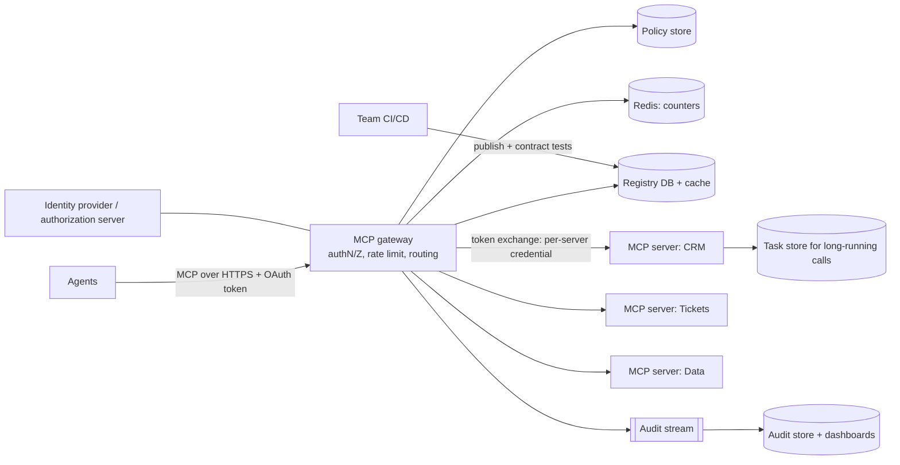

# Design an MCP Platform (Servers, Gateway and Registry)

A company-wide platform where many teams publish tools as MCP servers and many agents consume them safely. The challenge: **discovery, authentication and authorization per user, multi-tenancy, rate limiting, versioning and observability**, on a stateless protocol.

Protocol notes follow MCP revision `2026-07-28` (stateless requests, Streamable HTTP, OAuth-based authorization, Tasks extension). See [Tool Use and MCP](../02-core-concepts/17-tool-use-mcp-and-agent-protocols.md). Last verified: 2026-10.

## 1. Requirements

**Functional**
1. Teams register MCP servers (remote HTTP) in a **registry** with owner, version, tools and scopes.
2. Agents discover servers and call tools through a **gateway** with one endpoint and one identity model.
3. Admins set policy: who can use which tool, rate limits, approval requirements.
4. Long-running tools return durable task handles.

**Out of scope**: building the individual tools, model hosting, local stdio servers.

**Non-functional**
- Gateway overhead under 20 ms p95 per call; 99.95% availability.
- Scale: 500 servers, 5,000 tools, 20k tool calls/s peak across 1,000 tenants.
- Security: audience-bound tokens, no token passthrough, full audit of every call.
- Noisy neighbor protection per tenant and per tool.

## 2. Core Entities

- **Server** (url, owner, version, status), **Tool** (name, schema, scopes, risk level), **Tenant**, **Policy**, **Credential/Grant**, **Call record**, **Task**

## 3. API

```text
POST /mcp/{serverId}                 (MCP Streamable HTTP, JSON-RPC body; gateway endpoint)
GET  /.well-known/oauth-protected-resource/mcp/{serverId}
GET  /v1/registry/servers?query=     POST /v1/registry/servers     (publish new version)
PUT  /v1/policies/{id}               GET  /v1/audit?callId=
```

Each MCP request carries `MCP-Protocol-Version`, `Mcp-Method` and `Mcp-Name` headers mirrored from the body; the gateway routes and rate-limits on them without parsing the body, and the target server validates header and body match.

## 4. Data Flow

1. Agent calls `POST /mcp/{serverId}` with a bearer token.
2. Gateway authenticates (401 with `WWW-Authenticate` + resource metadata if missing), checks audience, policy and rate limit.
3. Gateway forwards to the server with a **server-specific** credential (token exchange), never the caller's token.
4. Response (JSON or SSE stream) flows back; call metadata goes to audit and metrics.
5. For long work the server returns a task; the agent polls via `tasks/get`.

## 5. High-Level Design



Because the protocol is stateless, **gateway and servers scale horizontally without sticky sessions**.

## 6. Deep Dives

### 6.1 Authentication and authorization
Servers behind the gateway are OAuth resource servers: they publish Protected Resource Metadata so clients discover the authorization server; the client requests tokens with the `resource` indicator, so each token is audience-bound to one server. The gateway validates audience and scopes, then performs **on-behalf-of token exchange** to call the server as the user, or uses a workload identity for autonomous agents. **Never forward the inbound token downstream** (confused deputy). Tool-level authorization (per tool and per argument constraints) lives in the policy engine, enforced in code, not in prompts. Step-up: `403 insufficient_scope` triggers reauthorization for risky tools.

### 6.2 Multi-tenancy and rate limiting
Counters keyed by `(tenant, server, tool)` in Redis with token bucket (see [Distributed Rate Limiter](../04-problem-breakdowns/distributed-rate-limiter.md)); separate limits for read and write tools and for concurrent streams. Bulkheads per server so one slow server does not exhaust gateway connections; circuit breakers with fallbacks. Quotas on **cost-bearing tools** (those that call paid APIs).

### 6.3 Discovery and versioning
Registry entries are immutable per version with a tool manifest, schema hash and risk level. Publishing runs contract tests and a security review (tool descriptions are untrusted text that models read, so scan for injection). Consumers pin major versions; the gateway routes by version and supports canary percentages. Description changes of a tool are treated as breaking, since they change agent behavior. Clients learn about list changes through an explicit subscription stream.

### 6.4 Long-running and streaming calls
Use the Tasks extension: gateway passes through task creation, stores `taskId -> server, tenant` mapping so polling and cancel hit the right server, enforces TTLs, and authorizes task access by the creator's identity. Streaming responses are request-scoped SSE; closing the stream cancels the call, so the gateway propagates disconnects.

### 6.5 Security hardening
Validate `Origin`, TLS everywhere, egress allow-list from servers, sandboxed execution for code tools, secrets in a vault. Quarantine servers whose descriptions change unexpectedly. Full audit: who (user, agent, tenant), which tool, arguments hash, result status, latency.

## 7. Staff-Level Notes

- **Trade-offs**: a central gateway gives uniform control but is a critical dependency (run multi-region, keep it thin); per-user token exchange costs latency (cache short-lived tokens).
- **Failure modes**: registry outage (cache last-known good), IdP outage (cached keys for validation, deny new logins), runaway agent loop hitting a tool (rate limit plus per-run budget), malicious server description.
- **Observability**: per-tool call rate, error rate, p99 latency, denials by policy, token exchange latency, task backlog, top tenants.
- **Evolution at 10x**: federated gateways per region or business unit, policy-as-code, automated tool-description scanning, usage-based chargeback.

### Agentic Concerns

| Concern | Answer for this design |
|---|---|
| Quality and evals | Contract tests per tool; agent-level evals measure tool-selection accuracy when catalog changes; description changes gated like code |
| Guardrails and security | Audience-bound tokens, no passthrough, per-tool policy, approval for high-risk tools, injection scan of descriptions and outputs |
| Cost per task | Per-tenant and per-tool quotas, budget headers from the agent runtime |
| Latency | Thin stateless gateway, cached policy and registry, header-based routing |
| Fallback | Circuit breaker returns a clear tool error the agent can handle; read-only mode during incidents |
