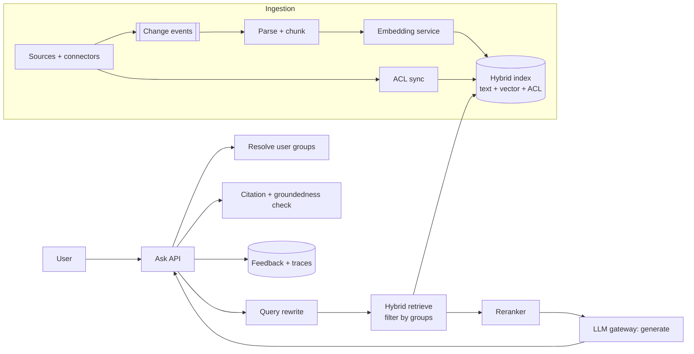

# Design a RAG Q&A System (Enterprise Knowledge Assistant)

Employees ask questions and get answers grounded in company documents, with citations, **respecting each user's access rights**. The challenge: retrieval quality, permission-aware search, freshness and measurable groundedness.

## 1. Requirements

**Functional**
1. Ask a question (with follow-ups) and get an answer with citations to source passages.
2. Ingest documents from connected sources (file shares, wikis, SharePoint-like sites) and keep them fresh.
3. Users only see answers derived from documents they can access.

**Out of scope**: authoring content, actions on other systems (see [Customer Support Agent](customer-support-agent.md)), multimodal parsing details.

**Non-functional**
- Answer p95 under 6 s end to end, TTFT under 2 s with streaming.
- Corpus: 50M chunks (~5M documents x ~10 chunks). At 1536 dims float32 that is ~300 GB of raw vectors, so we need a sharded or compressed index.
- Freshness: edits searchable within 10 minutes; deletes within 1 hour (compliance).
- Quality: groundedness above 95% on the golden set; abstain when unsupported.
- Security: zero cross-permission leakage.

## 2. Core Entities

- **Document** (source, ACL, version, owner), **Chunk** (text, embedding, metadata, ACL), **Query/Conversation**, **Answer** (text, citations), **Connector**, **IngestJob**

## 3. API

```text
POST /v1/ask   (SSE)   body: { conversationId?, question }  -> stream + citations[]
POST /v1/feedback      body: { answerId, rating, reason? }
GET  /v1/documents/{id}/preview?chunk=
PUT  /v1/connectors/{id}        (admin: configure source)
```

## 4. Data Flow

**Ingest**: source change event, fetch, parse, chunk, embed, upsert chunks with ACL, delete stale chunks.
**Query**: rewrite with history, hybrid retrieve with ACL filter, rerank, build prompt with numbered chunks, generate with citations, validate citations, stream.

## 5. High-Level Design



Index record: `chunkId, docId, text, vector, section, page, updatedAt, aclGroups[], tenantId`.

## 6. Deep Dives

### 6.1 Retrieval quality
Use hybrid search (BM25 plus vector, reciprocal rank fusion), then a cross-encoder reranker on the top 50, keeping ~8. Parent-child chunks: match on small chunks, send the parent section. Rewrite follow-ups into standalone queries and decompose multi-part questions (agentic retrieval fans out subqueries in parallel; costs more calls, so enable it for complex queries only). See [RAG](../02-core-concepts/15-embeddings-vector-search-rag.md).

### 6.2 Permission-aware retrieval
Store `aclGroups` on each chunk and filter inside the ANN query using the caller's group set (resolved from the identity token, cached briefly). Alternatives: per-tenant index (strong isolation, many indexes) or post-filtering (low recall and leak risk). ACL changes are propagated by a separate sync job, so permission revocation must be reflected within minutes; if the user's group lookup fails, **fail closed**.

### 6.3 Freshness and deletion
Change feed or webhook events drive incremental re-chunk and upsert, using content hashes to skip unchanged chunks. Deletions write tombstones and remove chunks. Re-embedding with a new model builds a second index and swaps an alias (blue/green). Track `indexedAt` lag per source and alert.

### 6.4 Grounding and citations
The model must cite chunk IDs from the context. Validate that every cited ID was provided and that cited text supports the claim (cheap NLI or LLM check on a sample). If top retrieval scores are below a threshold, **abstain** ("I could not find this in the documents") rather than guess.

### 6.5 Scale and cost
50M vectors: shard the index by tenant or hash, quantize vectors (int8 or binary with rescoring) to cut memory 4-32x, keep replicas for QPS. Cache query embeddings and popular answers (tenant and ACL scoped). Largest cost is generation: limit chunks, use a smaller model for rewrite and rerank steps.

## 7. Staff-Level Notes

- **Trade-offs**: more chunks raise recall but cost tokens and distract the model; reranking adds ~100-300 ms but is usually worth it.
- **Failure modes**: stale ACLs (leak), embedding model drift, parser failures silently dropping content (monitor docs-per-source counts), prompt injection hidden in documents.
- **Observability**: recall@k on labeled queries, groundedness score, abstain rate, retrieval latency, ingestion lag, no-result rate, thumbs down by source.
- **Evolution at 10x**: per-source tuning, multimodal, graph retrieval for relationship questions, user-level personalization.

### Agentic Concerns

| Concern | Answer for this design |
|---|---|
| Quality and evals | Labeled query set for recall@k and nDCG; LLM-judged groundedness and citation accuracy; gate index or prompt changes |
| Guardrails and security | ACL filter in the query, fail closed, treat document text as untrusted data, no tools with side effects |
| Cost per task | Rerank to few chunks, small model for rewrite, cache embeddings, quantized vectors |
| Latency | Parallel subqueries, stream the answer, rerank only top-N |
| Fallback | Keyword-only search if vector service is down, "no answer" instead of hallucination |
